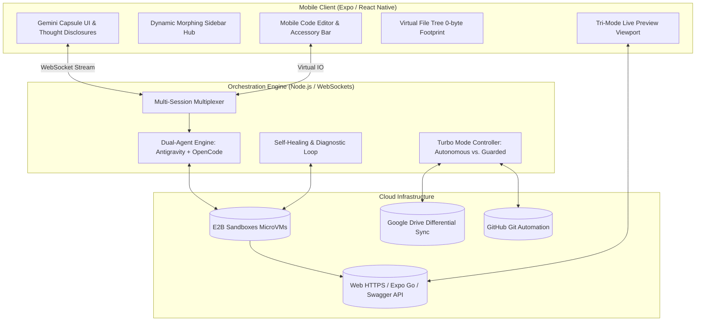

# QuickKode ⚡📱

> Command autonomous coding agents (**Google Antigravity** & **OpenCode**) from your mobile phone, working on project files synchronized two-way with **Google Drive**, backed by isolated microVM sandboxes (**E2B**), committing and pushing to **GitHub**, and testing live across **Web (HTTPS tunnels)**, **Mobile (Expo Go deep-links)**, and **Backend APIs**.

---

## 🏗 System Architecture

QuickKode is built as a TypeScript monorepo with three core workspaces:

```
QuickKode/
├── packages/
│   └── shared/                 # Shared TypeScript models, contracts, and Zod schemas
├── services/
│   └── orchestrator/           # Cloud backend: E2B MicroVMs, Git, Drive sync & WebSocket hub
└── apps/
    └── mobile/                 # React Native / Expo mobile client (Gemini capsule UI)
```



---

## 🚀 Key Capabilities

### 1. Zero-Byte Phone Footprint
- Never clones heavy repositories or `node_modules` to your phone.
- Virtual directory structure streamed over WebSockets.
- Edits are performed on single files and streamed directly to cloud microVMs.

### 2. Dual-Agent Engine
- **Google Antigravity:** Connects directly to your PC Antigravity quota and subscription without an API key (or falls back to Gemini API).
- **OpenCode (BYOK):** DeepSeek Coder V2, Claude 3.5 Sonnet, and GPT-4o support for multi-model flexibility.

### 3. Google Drive Differential Sync & `.driveignore`
- Solves cloud sync locks by filtering `node_modules`, `.git`, `.next`, and cache folders.
- MD5 delta sync transmits only modified source files.

### 4. Tri-Mode Live Mobile Testing
- **Web:** HTTPS tunneling for Next.js, Vite, CRA, and static apps.
- **Mobile:** Expo Go `exp://` deep-link and QR code generation for instant on-device testing.
- **Backend APIs:** Automatic endpoint discovery and in-app HTTP tester with formatted JSON output.

### 5. Autonomous Turbo Mode
- **Turbo Mode (Enabled):** Agent iterates, edits, runs tests, self-heals broken builds, and commits/pushes automatically.
- **Standard Mode (Guarded):** Visual diff review gate before any commit or Drive sync is approved.

---

## 🛠 Getting Started

### Prerequisites
- Node.js >= 18.0.0
- npm >= 9.0.0
- E2B API Key (set via `E2B_API_KEY` environment variable)

### Installation
```bash
# Clone the repository
git clone https://github.com/D3MONOXXIZZ/QuickKode.git
cd QuickKode

# Install dependencies across all workspaces
npm install
```

### Running Tests
```bash
# Run complete test suite across all packages (165 tests)
npm run test

# Run TypeScript typechecks
npm run typecheck
```

### Starting the Orchestrator Server
```bash
npm --workspace=@quickkode/orchestrator run build
npm --workspace=@quickkode/orchestrator start
```

### Launching the Mobile App
```bash
npm --workspace=@quickkode/mobile start
```

---

## 📦 Package Directory

| Workspace | Description | Tests |
| :--- | :--- | :---: |
| [`@quickkode/shared`](file:///F:/QuickKode/packages/shared) | Type definitions, Zod validation schemas, and client/server socket protocols | 10 |
| [`@quickkode/orchestrator`](file:///F:/QuickKode/services/orchestrator) | MicroVM sandbox management, Git client, Drive differential sync, and Agent runner | 123 |
| [`@quickkode/mobile`](file:///F:/QuickKode/apps/mobile) | React Native Expo application, capsule input bar, file tree, code editor, and diff viewer | 32 |

---

## 📄 License
MIT © D3MONOXXIZZ
